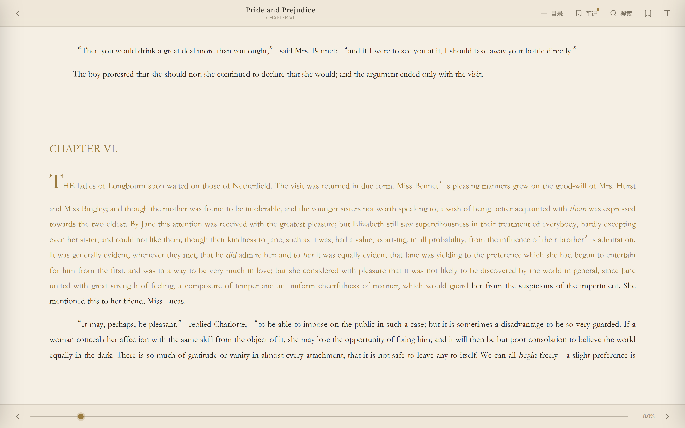

# 星皓书房 · Xinghao Library

**Calibre 驱动的自托管个人数字图书馆，阅读器体验对标 Koodo Reader。**

[](LICENSE)
[](https://www.python.org/)
[](docker-compose.yml)

Calibre 负责藏书与元数据，星皓书房负责「把书读好」。指向你已有的 Calibre 书库目录即可启动，不迁移、不改写、不导入——书还是那些书，只是终于有一个愿意一直打开的阅读界面。

---

## 目录

- [这是什么](#这是什么)
- [特性](#特性)
- [界面预览](#界面预览)
- [快速开始](#快速开始)
- [接入你的 Calibre 库](#接入你的-calibre-库)
- [数据与隐私](#数据与隐私)
- [技术栈](#技术栈)
- [项目结构](#项目结构)
- [路线图](#路线图)
- [文档](#文档)
- [常见问题](#常见问题)
- [贡献](#贡献)
- [致谢](#致谢)
- [许可证](#许可证)

## 这是什么

市面上的自托管书库大多解决「管理」，很少解决「阅读」；而优秀的阅读器（Koodo Reader、Readest）又需要把书重新导入一遍。星皓书房把两者接起来：

- **数据面**：直接读取 Calibre 的 `metadata.db` 与书文件，Calibre 桌面端仍是唯一写入方，永远不会被 Web 端改坏。
- **阅读面**：EPUB 阅读器按 Koodo 的信息架构重做——目录抽屉、独立排版面板、四套主题、划词高亮与笔记、全文搜索、键盘与手势翻页。
- **记录面**：进度、书签、划线、笔记存在应用自己的 SQLite 里，换浏览器、换设备都能接着读。
- **部署面**：单个 Python 进程 + 零构建前端，`docker compose up` 一条命令跑在 NAS 或 VPS 上。

适合：有一个 Calibre 书库、希望在家里/内网随时打开就读、并且对阅读界面有要求的个人用户。

## 特性

### 书架

| 能力 | 说明 |
|---|---|
| 封面墙 | 自动读取 Calibre 封面；无封面时按书名生成渐变书封，风格与静态书房一致 |
| 检索 | 书名、作者、系列、标签、简介全文匹配 |
| 筛选 | 按作者、标签、系列、语言筛选，支持组合 |
| 排序 | 最近添加、书名、作者、出版日期、评分 |
| 继续阅读 | 首页展示最近在读，一键回到上次位置 |

### 阅读器

| 能力 | 说明 |
|---|---|
| 布局 | 单栏分页、双栏分页、滚动三种模式，随窗口自适应 |
| 排版 | 字体、字号、行距、页边距、对齐方式即时生效并记住 |
| 主题 | 羊皮纸、纯白、护眼绿、夜间四套，独立于站点主题 |
| 导航 | 目录树跳转、进度条拖拽、页码/百分比显示 |
| 批注 | 划词高亮（四色）、附加笔记、侧栏统一管理、点击回跳原文 |
| 书签 | 记当前位置与章节名，侧栏可跳转、可删除 |
| 搜索 | 全书文本搜索，结果显示章节与上下文，点击定位 |
| 输入 | 键盘 ← → 空格 Esc、触摸左右滑动、点击左右区域翻页 |
| 进度 | 防抖写入，刷新或换设备后精确回到原 CFI |

### 数据

- **Calibre 只读**：仅依赖 Calibre 长期稳定的元数据表，缺失表自动降级。
- **自有数据库**：`progress` / `bookmarks` / `annotations` 三张表，单文件备份。
- **私有默认**：笔记默认只对本人可见；M1 无多用户，天然隔离。
- **无遥测**：不向任何外部服务发送请求。

### 部署

- Docker Compose，单容器，无 Node、无 Nginx、无 Redis。
- 书库以只读方式挂载（`:ro`），容器无法破坏 Calibre 数据。
- 自带演示书库（公版书），空库也能立刻看到界面。

## 界面预览

| 书架 | 书籍详情 |
|---|---|
|  |  |



## 快速开始

### 方式一：Docker（推荐）

```bash
git clone https://github.com/Lumenhao/Library.git
cd Library

# 指向你的 Calibre 书库；不写这一行则使用仓库自带的演示库
echo "CALIBRE_PATH=D:/Calibre Library" > .env

docker compose up -d
```

打开 <http://localhost:8080>。`CALIBRE_PATH` 支持 Windows 盘符路径（`D:/Calibre Library`）与 Linux/macOS 绝对路径（`/mnt/books/Calibre`），换库只需改 `.env` 后 `docker compose up -d`。

### 方式二：本地运行

需要 Python 3.11 及以上。

```bash
git clone https://github.com/Lumenhao/Library.git
cd Library

python -m venv .venv
source .venv/bin/activate        # Windows: .venv\Scripts\activate
pip install -r app/requirements.txt

# Windows PowerShell
$env:LIBRARY_PATH = "D:\Calibre Library"
python -m app.main

# macOS / Linux
LIBRARY_PATH="/path/to/Calibre Library" python -m app.main
```

默认监听 `127.0.0.1:8080`，可用 `HOST` / `PORT` 覆盖。

### 可用环境变量

| 变量 | 默认值 | 说明 |
|---|---|---|
| `LIBRARY_PATH` | `demo-library` | Calibre 书库根目录（含 `metadata.db`） |
| `DATA_DIR` | `data` | 应用自有数据目录（进度、书签、笔记） |
| `HOST` | `127.0.0.1` | 监听地址，容器内为 `0.0.0.0` |
| `PORT` | `8080` | 监听端口 |
| `SITE_NAME` | `星皓书房` | 站点标题 |
| `LIBRARY_PASSWORD` | 空 | 设置后启用 HTTP Basic 口令 |

`CALIBRE_PATH` 只在 Compose 里使用，用来指定挂载进容器的书库目录，默认 `./demo-library`。

## 接入你的 Calibre 库

1. 在 Calibre 桌面端确认书库位置：**首选项 → 更改 Calibre 库 → 当前库**，记下目录路径。
2. 该目录下应有 `metadata.db` 和若干 `作者/书名 (id)/` 文件夹。
3. 让 `LIBRARY_PATH`（或 Compose 的挂载路径）指向这个目录。

应用只读该目录，不会新增、移动或改写任何文件。新书仍然通过 Calibre 添加，刷新页面即可看到。

> 没有现成书库？仓库自带 `demo-library/`，由 [公版书](docs/demo-library.md) 生成，可直接体验。重新生成：`python tools/build_demo_library.py`。

## 数据与隐私

| 数据 | 存放位置 | 备份 |
|---|---|---|
| 书籍与元数据 | 你的 Calibre 目录 | 由 Calibre 自身备份策略负责 |
| 阅读进度、书签、笔记 | `DATA_DIR/library.db` | 复制该文件即可 |
| 阅读器偏好（主题/字号） | 浏览器 localStorage | 无需备份 |

应用不收集统计、不上报崩溃、不访问外网。唯一的出站请求是你自己在阅读器里打开的书内链接。

## 技术栈

| 层 | 技术 | 说明 |
|---|---|---|
| 后端 | Python · FastAPI · uvicorn | 异步文件流、OpenAPI 文档 |
| 书库 | Calibre `metadata.db`（SQLite，只读） | 零迁移接入 |
| 应用数据 | SQLite | 单文件、零运维 |
| 前端 | 原生 ES Modules + 手写 CSS | 无构建步骤，改完即生效 |
| 阅读内核 | [epub.js](https://github.com/futurepress/epub.js) | 分页、CFI、主题、高亮 |
| 部署 | Docker Compose | NAS / VPS 通用 |

设计取舍、数据模型与 API 约定见 **[docs/ARCHITECTURE.md](docs/ARCHITECTURE.md)**。

## 项目结构

```
Library/
├── app/                      # 自托管应用（Calibre 书架 + 阅读器）
│   ├── main.py               # FastAPI 入口与路由
│   ├── calibre.py            # Calibre metadata.db 只读访问
│   ├── store.py              # 自有 SQLite：进度 / 书签 / 笔记
│   ├── config.py             # 环境变量
│   └── static/               # 前端（无构建）
│       ├── index.html        # 书架与详情
│       ├── reader.html       # 阅读器
│       ├── css/              # 设计系统
│       ├── js/               # api / library / reader
│       └── vendor/           # epub.js
├── demo-library/             # 演示用 Calibre 库（公版书）
├── tools/build_demo_library.py
├── content/  layouts/  assets/  static/  themes/   # Hugo 静态书房
├── docs/                     # 产品、架构、路线图、静态站说明
├── docker-compose.yml
├── Dockerfile
└── .github/workflows/        # 静态书房的 GitHub Pages 发布
```

仓库同时包含两部分：

- **自托管应用**（`app/`）：Calibre 书架 + 阅读器，需要一台常开的机器。
- **静态书房**（`content/` 等）：Hugo 生成的纯静态站点，发布在 GitHub Pages，适合公开展示。使用方式见 [docs/USAGE.md](docs/USAGE.md)。

## 路线图

| 阶段 | 内容 | 状态 |
|---|---|---|
| M0 | 静态书房（Hugo + GitHub Pages） | 已发布 |
| **M1** | Calibre 只读接入、书架、详情、Koodo 级 EPUB 阅读器、进度/书签/笔记 | 已完成 |
| M2 | 上传入库、格式转换、元数据轻编辑、回收站、PDF 与漫画阅读 | 计划 |
| M3 | 多用户与权限、OPDS、设备推送、跨端进度 | 计划 |
| M4 | 服务端全文索引、统计、推荐、静态站导出、TTS | 计划 |

详细验收条件见 [docs/ROADMAP.md](docs/ROADMAP.md)。

## 文档

| 文档 | 内容 |
|---|---|
| [docs/PRODUCT.md](docs/PRODUCT.md) | 定位、角色、竞品对照、优先级与验收 |
| [docs/ARCHITECTURE.md](docs/ARCHITECTURE.md) | 技术选型、数据模型、API、阅读器设计、安全 |
| [docs/ROADMAP.md](docs/ROADMAP.md) | 里程碑与不做清单 |
| [docs/USAGE.md](docs/USAGE.md) | 静态书房：加书、写作语法、发布到 GitHub Pages |
| [docs/demo-library.md](docs/demo-library.md) | 演示书库的构成与再生成 |

## 常见问题

**会修改我的 Calibre 书库吗？**
不会。书库以只读方式访问，应用没有任何写书库的代码路径（M2 的转换与元数据编辑会通过 Calibre CLI 显式执行，并先做备份）。

**支持哪些格式？**
M1 在线阅读 EPUB；PDF 通过浏览器原生查看器打开；MOBI/AZW3 需先在 Calibre 中转换（M2 将内置调用 `ebook-convert`）。

**能部署到 GitHub Pages 吗？**
不能。GitHub Pages 只能托管静态文件，书架与阅读进度需要后端。若只想要公开展示，请使用仓库里的静态书房。

**书库很大（上万本）会慢吗？**
列表走服务端分页与索引，按需读取，不会一次性加载全库。封面为按需请求并带缓存。

**忘记密码 / 想关闭登录？**
`LIBRARY_PASSWORD` 为空时不启用登录。建议仅在可信内网使用，或置于反向代理之后。

## 贡献

欢迎 Issue 与 Pull Request。提交前请：

1. 阅读 [docs/ARCHITECTURE.md](docs/ARCHITECTURE.md) 的约束（Calibre 只读、无构建前端）。
2. 一个 PR 只做一件事，说明动机而非仅描述改动。
3. 涉及界面改动的 PR 请附桌面与移动端截图。

## 致谢

- [Calibre](https://calibre-ebook.com/) —— 书库与元数据的事实标准。
- [talebook](https://github.com/talebook/talebook) —— 产品逻辑与阅读状态、划线笔记的语义参考。
- [Koodo Reader](https://github.com/koodo-reader/koodo-reader) —— 阅读器信息架构的标杆。
- [epub.js](https://github.com/futurepress/epub.js) —— EPUB 渲染内核。
- [hugo-book](https://github.com/alex-shpak/hugo-book) —— 静态书房主题。
- [Yuanuite/digital-library](https://github.com/yuanuite/digital-library) —— 静态书房最初的结构灵感。

演示书库中的英文书籍来自 [Project Gutenberg](https://www.gutenberg.org/)，均为公有领域作品。

## 许可证

[MIT](LICENSE) © 2026 Haoming Xing
