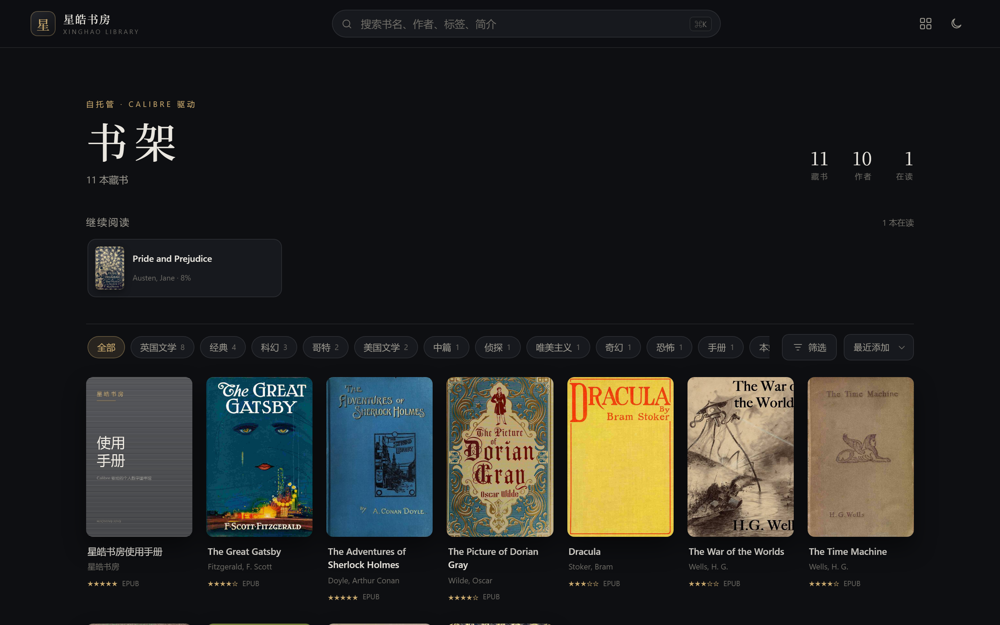

<div align="center">

# 星皓书房 · Lumen

**把你的藏书，点亮成一座私人星图。**

一个自托管的个人数字图书馆：原地读取你的 Calibre 书库，<br>
再配上一间值得久坐的阅读室。

[English](README.md) · **简体中文**

[](LICENSE)
[](https://www.python.org/)
[](docker-compose.yml)
[](https://calibre-ebook.com/)

</div>

---

Calibre 很擅长替你**收书**，只是它从来不是用来**读书**的地方。

Lumen 指向你早已整理好的 Calibre 书库，只读地把它读进来，再在上面盖一间安静的阅读室：四套阅读主题、真正的分页排版、刷新也不丢的划线笔记。没有导入步骤，没有第二份书库，也不会背着 Calibre 改写任何元数据。

```bash
git clone https://github.com/Lumenhao/Lumen.git && cd Lumen
docker compose up -d          # → http://localhost:8080
```



## 这是什么

市面上的自托管书库大多解决「管理」，很少解决「阅读」；而优秀的阅读器（Koodo Reader、Readest）又要求你把书再导入一遍。Lumen 把两半接起来：

- **数据面**：直接读取 Calibre 的 `metadata.db` 与书文件。Calibre 桌面端仍是唯一的写入方，Web 端没有任何能改动书库的代码路径。
- **阅读面**：EPUB 阅读器按 Koodo 的信息架构重做——目录抽屉、独立排版面板、四套主题、四色划线、侧栏笔记、全文搜索、键盘与手势翻页。
- **记录面**：进度、书签、划线、笔记存在应用自己的 SQLite 里。换浏览器、换设备，都能接着上一页读。
- **部署面**：单个 Python 进程、零构建前端、单容器。`docker compose up` 跑在 NAS、VPS，或桌下那台小主机上。

适合：已经有一个 Calibre 书库、希望在家里随手打开就读、并且在意页面好不好看的个人用户。

## 特性

### 书架

| | |
|---|---|
| **封面墙** | 自动读取 Calibre 封面；没有封面时按书名生成渐变书封 |
| **检索** | 书名、作者、系列、标签、简介，一个输入框全匹配 |
| **筛选** | 按作者、标签、系列、语言组合筛选 |
| **排序** | 最近添加、书名、作者、出版日期、评分 |
| **继续阅读** | 首页展示最近在读，一键回到上次的确切位置 |

### 阅读器

| | |
|---|---|
| **布局** | 单栏分页、双栏分页、滚动三种模式，随窗口自适应 |
| **排版** | 字体、字号、行距、页边距、对齐方式即时生效并被记住 |
| **主题** | 米黄、纯白、护眼绿、夜读，独立于站点主题 |
| **导航** | 目录树跳转、进度条拖拽、页码与百分比 |
| **划线** | 划词四色高亮，可附笔记，侧栏统一管理，点击回跳原文 |
| **书签** | 记录当前位置与章节名，侧栏可跳转、可删除 |
| **搜索** | 全书文本检索，显示章节与上下文，点击定位 |
| **输入** | 键盘（← → 空格 Esc）、左右滑动、点击翻页 |
| **进度** | 防抖写入，刷新或换设备后精确还原到原来的 CFI |

### 数据与部署

- **Calibre 只读**：只依赖长期稳定的元数据表，缺表时自动降级。
- **自有数据库**：`progress` / `bookmarks` / `annotations` 三张表，单文件即可备份。
- **默认私有**：没有账号体系，没有遥测，不向外发请求；需要暴露到内网之外时，可开启 HTTP Basic 口令。
- **运维无聊**：单容器，无 Node、无 Nginx、无 Redis；内置健康检查；书库以 `:ro` 挂载。
- **中英双语**：界面自带中文与英文，默认跟随浏览器 `Accept-Language`，也可用 `LOCALE=zh` / `LOCALE=en` 固定。
- **自带演示库**：仓库里有一小份公版书构成的 Calibre 库，首次启动界面不会是空的。

## 命名与中文原义

**星皓书房** 要一个字一个字地读：

| 字 | 读音 | 含义 |
|---|---|---|
| 星 | xīng | 星子——散落在书架上的每一本书 |
| 皓 | hào | 明亮、光洁；也正好是作者名字 皓鸣 里的那一个字 |
| 书房 | shū fáng | 读书的那间屋子 |

合起来是：**一间被星光照亮的书房**——每本书都是一个光点。

**Lumen** 是它的英文名。拉丁语里意为「光」；在物理里，它是国际单位制中光通量的单位（流明），描述一个光源发出的全部光。取名于此，是因为它与「皓」同义，与作者的用户名 [@Lumenhao](https://github.com/Lumenhao) 同首字母，也正好说明了这个软件在做什么：Lumen 不收藏书，它把书点亮。

## 快速开始

一套代码，两个版本。按你打算运行它的机器挑一个。

| | Docker 版 | Python 版 |
|---|---|---|
| **需要** | Docker + Compose | Python 3.11+ |
| **适合** | NAS、VPS、长期常开的机器 | 你自己的笔记本或台式机 |
| **启动** | `docker compose up -d` | 双击 `start.bat`，或 `bash start.sh` |
| **数据** | 命名卷 `library-data` | 项目目录下的 `data/` |
| **升级** | `git pull && docker compose up -d --build` | `git pull` 后重新启动 |

两个版本读同一份仓库根目录的 `.env`：书库路径只写一次，换版本不用重新配置。

### Docker 版

```bash
git clone https://github.com/Lumenhao/Lumen.git
cd Lumen

# 指向你的 Calibre 书库；不写这一行则使用仓库自带的演示库
echo "CALIBRE_PATH=D:/Calibre Library" > .env

docker compose up -d
```

打开 <http://localhost:8080>。`CALIBRE_PATH` 支持 Windows 盘符路径（`D:/Calibre Library`）与 POSIX 绝对路径（`/mnt/books/Calibre`）。换库只需改 `.env` 后再次 `docker compose up -d`。

### Python 版

```bash
git clone https://github.com/Lumenhao/Lumen.git
cd Lumen

echo "CALIBRE_PATH=D:/Calibre Library" > .env   # 可选，与上面是同一个文件
```

- **Windows**：双击 `start.bat`。
- **macOS / Linux**：运行 `bash start.sh`。

脚本会创建 `.venv`、安装两个依赖、启动服务并打开浏览器。不往系统里装任何东西，删掉 `.venv/` 即还原。

喜欢自己敲命令的话：

```bash
python -m venv .venv
source .venv/bin/activate        # Windows: .venv\Scripts\activate
pip install -r app/requirements.txt
python -m app.main
```

默认监听 `127.0.0.1:8080`；在 `.env` 里设 `HOST=0.0.0.0` 可从局域网其他设备访问。

### 环境变量

| 变量 | 默认值 | 作用 |
|---|---|---|
| `LIBRARY_PATH` | `demo-library` | Calibre 书库根目录（含 `metadata.db`）；在 `.env` 里写 `CALIBRE_PATH` 等效 |
| `DATA_DIR` | `data` | 应用数据目录（进度、书签、笔记） |
| `HOST` | `127.0.0.1` | 监听地址（容器内为 `0.0.0.0`） |
| `PORT` | `8080` | 监听端口 |
| `SITE_NAME` | `星皓书房` | 界面标题 |
| `LOCALE` | `auto` | 界面语言：`auto` 跟随浏览器，也可固定为 `zh` / `en` |
| `LIBRARY_PASSWORD` | 空 | 设置后启用 HTTP Basic 口令 |

`CALIBRE_PATH` 是 Compose 挂载进容器的主机目录；Python 版把它直接当作书库路径。

## 接入你的 Calibre 库

1. 在 Calibre 桌面端确认书库位置：**首选项 → 更改 Calibre 库 → 当前库**，记下目录路径。
2. 该目录下应有 `metadata.db`，以及每本书的 `作者/书名 (id)/` 文件夹。
3. 让 `LIBRARY_PATH`（或 Compose 的挂载路径）指向这个目录。

应用只读该目录，不会新增、移动或改写任何文件。新书仍然通过 Calibre 添加，刷新页面即可看到。

> 还没有书库？仓库自带 `demo-library/`，由[公版书](docs/demo-library.md)生成，可直接体验。重新生成：`python tools/build_demo_library.py`。

## 数据与隐私

| 数据 | 存放位置 | 备份 |
|---|---|---|
| 书籍与元数据 | 你的 Calibre 目录 | 沿用 Calibre 自己的备份策略 |
| 阅读进度、书签、笔记 | `DATA_DIR/library.db` | 复制该文件即可 |
| 阅读器偏好 | 浏览器 `localStorage` | 无需备份 |

没有统计、不上报崩溃、不访问外部服务。唯一的出站请求，是你在书里亲手点开的外链。

## 技术栈

| 层 | 技术 | 取舍 |
|---|---|---|
| 后端 | Python · FastAPI · uvicorn | 异步文件流，顺带拿到 OpenAPI |
| 书库 | Calibre `metadata.db`（只读 SQLite） | 零迁移 |
| 应用数据 | SQLite | 单文件，零运维 |
| 前端 | 原生 ES Modules + 手写 CSS | 无构建步骤，改完刷新即生效 |
| 阅读内核 | [epub.js](https://github.com/futurepress/epub.js) | 分页、CFI、主题、高亮 |
| 交付 | Docker Compose | NAS 与 VPS 通用 |

设计约束、数据模型与 API 约定见 **[docs/ARCHITECTURE.md](docs/ARCHITECTURE.md)**。

## 项目结构

```
lumen/
├── app/                      # 自托管应用
│   ├── main.py               # FastAPI 入口与路由
│   ├── calibre.py            # Calibre metadata.db 只读访问
│   ├── store.py              # 自有 SQLite：进度 / 书签 / 笔记
│   ├── config.py             # 环境变量
│   └── static/               # 前端（无构建）
│       ├── index.html        # 书架与详情
│       ├── reader.html       # 阅读器
│       ├── css/              # 设计系统
│       ├── js/               # api / library / reader
│       └── vendor/           # epub.js
├── demo-library/             # 演示用 Calibre 库（公版书）
├── tools/build_demo_library.py
├── content/  layouts/  assets/  static/  themes/   # Hugo 站点（落地页）
├── docs/                     # 产品、架构、路线图、使用说明
├── start.bat  start.sh       # Python 版一键启动脚本
├── docker-compose.yml
├── Dockerfile
└── .github/workflows/        # 把 Hugo 站点发布到 GitHub Pages
```

仓库包含两件事：`app/` 里的**自托管应用**，以及 `content/` / `layouts/` / `assets/` 里生成落地页的 **Hugo 站点**。静态站点的用法见 [docs/USAGE.md](docs/USAGE.md)。

## 路线图

| 阶段 | 内容 | 状态 |
|---|---|---|
| M0 | Hugo 静态书房 + GitHub Pages | 已发布 |
| **M1** | Calibre 只读接入、书架、详情、Koodo 级 EPUB 阅读器、进度 / 书签 / 笔记 | **已完成** |
| M2 | 应用内上传、格式转换、元数据轻编辑、回收站、PDF 与漫画阅读 | 计划 |
| M3 | 多用户与权限、OPDS、设备推送、跨端进度 | 计划 |
| M4 | 服务端全文索引、统计、推荐、静态站导出、TTS | 计划 |

验收条件见 [docs/ROADMAP.md](docs/ROADMAP.md)。

## 文档

| 文档 | 内容 |
|---|---|
| [docs/PRODUCT.md](docs/PRODUCT.md) | 定位、角色、竞品对照、优先级与验收 |
| [docs/ARCHITECTURE.md](docs/ARCHITECTURE.md) | 技术选型、数据模型、API、阅读器设计、安全 |
| [docs/ROADMAP.md](docs/ROADMAP.md) | 里程碑与「不做」清单 |
| [docs/USAGE.md](docs/USAGE.md) | 静态站点：加书、写作语法、发布到 GitHub Pages |
| [docs/demo-library.md](docs/demo-library.md) | 演示书库的构成与再生成 |

## 常见问题

**会修改我的 Calibre 书库吗？**
不会。书库以只读方式挂载，代码里没有写入书库的路径。M2 的转换与元数据编辑会通过 Calibre 自己的命令行显式执行，并先做备份。

**支持哪些格式？**
EPUB 在应用内直接阅读；PDF 调用浏览器原生查看器；MOBI / AZW3 需要先在 Calibre 里转换一次，`ebook-convert` 集成在 M2 计划中。

**一定要装 Docker 吗？**
不用。Python 版只需 Python 3.11+：Windows 双击 `start.bat`，macOS / Linux 运行 `bash start.sh`，虚拟环境由脚本自己管理。Docker 版适合常开机器；两版共用同一份 `.env` 和同一套数据模型。

**能部署到 GitHub Pages 吗？**
不能。Pages 只托管静态文件，而书架与阅读进度需要后端。仓库里的 Hugo 站点是它的静态搭档。

**书库很大（上万本）会慢吗？**
书架在服务端分页并建立索引，按需读取；封面懒加载并带缓存。

**忘记密码 / 想关闭登录？**
`LIBRARY_PASSWORD` 留空即不启用。超出可信内网的使用场景，建议放在反向代理之后。

**拉取基础镜像失败？**
部分网络无法直连 Docker Hub。可以给 Docker Desktop 配镜像加速器（Settings → Docker Engine → `registry-mirrors`），或先用镜像站拉取 `python:3.13-slim`，`docker tag` 成本地标签后再构建。

## 贡献

欢迎 Issue 与 Pull Request。

1. 先读 [docs/ARCHITECTURE.md](docs/ARCHITECTURE.md) 里的约束：Calibre 只读、前端无构建。
2. 一个 PR 只做一件事，说明动机而不只是描述改动。
3. 界面改动请附桌面与移动端截图。

## 致谢

- [Calibre](https://calibre-ebook.com/) —— 书库与元数据的事实标准。
- [talebook](https://github.com/talebook/talebook) —— 产品逻辑，以及阅读状态、划线笔记的语义参考。
- [Koodo Reader](https://github.com/koodo-reader/koodo-reader) —— 阅读器信息架构的标杆。
- [epub.js](https://github.com/futurepress/epub.js) —— EPUB 渲染内核。
- [hugo-book](https://github.com/alex-shpak/hugo-book) —— 静态站点主题。
- [Yuanuite/digital-library](https://github.com/yuanuite/digital-library) —— 静态站点最初的结构灵感。

演示书库中的英文书籍来自 [Project Gutenberg](https://www.gutenberg.org/)，均为公有领域作品。

## 许可证

[MIT](LICENSE) © 2026 Haoming Xing

<div align="center"><sub>[English](README.md) · [简体中文](README.zh-CN.md)</sub></div>
