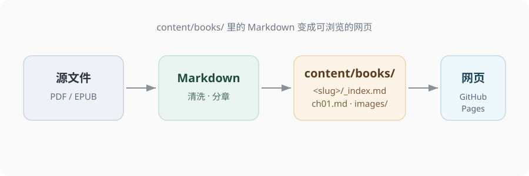

# 第1章 · 结构与导航

一本书就是一个文件夹。Hugo 按文件夹里的 Markdown 生成网页，不需要数据库，也不需要后台。

## 一本书的文件夹

```
content/books/library-guide/
├── _index.md      ← 封面：书名、简介、目录
├── ch01.md        ← 正文第一章
├── ch02.md
├── ch03.md
└── images/        ← 这本书用到的图片
    └── pipeline.svg
```

`_index.md` 是封面页，其余 Markdown 按 `weight` 从小到大排成章节。`weight` 建议用 10、20、30，将来在中间插一章不用重新编号。


图1.1　一本书变成网页的流程

## 导航是自动的

- **侧栏**：读取每本书 `categories` 的第一项作为分组
- **目录**：封面页里的 `` 自动列出所有章节和它们的 `description`
- **翻页**：每章底部自动出现「上一章 / 下一章」，封面底部是「开始阅读」


把 `library-guide` 整个文件夹复制一份，改名成你的新书 slug，再替换 `_index.md` 里的书名、作者、简介，删掉旧章节，放入新章节。首页书架加一行链接即可。



- 一本书 = `content/books/<slug>/` 一个文件夹
- `_index.md` 是封面，`ch*.md` 是章节，`images/` 放图
- 侧栏分组来自 `categories`，排序来自 `weight`

