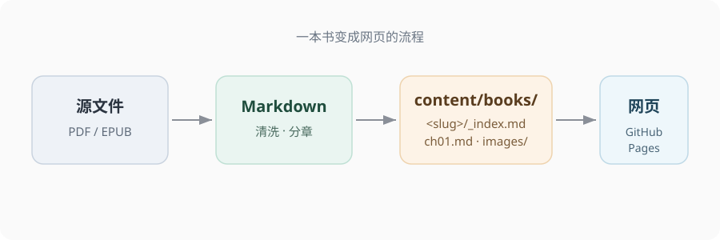

本页列出全部内容元素的写法与实际渲染效果，写书时直接抄。

## 提示框 callout

`type` 控制配色：`tip` 蓝、`note` 灰、`warning` 橙、`important` 红。

```markdown

内容……

```


这是一个 tip 提示框，用于补充有用的小技巧。



不要混淆 $P(s'|s,a)$ 和 $P(s'|s)$——前者依赖动作，后者不依赖。


## 定义 definition

```markdown

定义内容……

```


一个 MDP 由状态集 $S$、动作集 $A$、转移概率 $P(s'|s,a)$、奖励函数 $R$ 和折扣因子 $\gamma$ 组成。其核心性质是**马尔可夫性**：未来只取决于当前状态和动作，与历史无关。


## 定理 theorem

`type` 可选：定理（默认）、引理、命题、推论。

```markdown

陈述……

```


最优状态价值函数满足：
$$
V^*(s) = \max_a \sum_{s'} P(s'|s,a) \left[ R(s,a,s') + \gamma V^*(s') \right]
$$


## 例题 example

内部可以再嵌一个 `solution` 显示解答。

```markdown

题目……

解答……


```


一维紧束缚链的色散为 $E(k) = -2t \cos(ka)$，求能带宽度。


$E(k)$ 在 $k=0$ 取最小值 $-2t$，在 $k=\pi/a$ 取最大值 $2t$，故带宽 $W = 4t$。



## 解答块 solution

不嵌在例题里时，单独用于习题解答，绿色左边框。

```markdown

解答：……

```


独立解答块，内部可写 Markdown 和公式 $E[X] = \sum_i p_i x_i$。


## 图注 caption

紧接图片或表格之后，居中显示小字。

```markdown

图1.1　这是图注
```


图1.1　示例图注

## 要点 key-point

章末总结，浅色背景整块。

```markdown

本章要点……

```


- 公式用 `$...$` 与 `$$...$$`
- 图片放 `images/`，路径写相对路径
- 章节 `weight` 用 10、20、30


## 算法块 algorithm

外层 `algorithm` 短代码加标题，里面是 `<pre class="pseudocode">`。

```markdown

<pre class="pseudocode">
\begin{algorithm}
\caption{算法 1: Sarsa}
\begin{algorithmic}
\REQUIRE episodes, $\alpha$, $\gamma$
\FOR{each episode}
    \STATE $S \leftarrow$ first state
    \REPEAT
        \STATE $Q(S, A) \leftarrow Q(S, A) + \alpha(R + \gamma Q(S', A') - Q(S, A))$
    \UNTIL{$S$ is terminal state}
\ENDFOR
\end{algorithmic}
\end{algorithm}
</pre>

```


<pre class="pseudocode">
\begin{algorithm}
\caption{算法 1: Sarsa}
\begin{algorithmic}
\REQUIRE episodes, $\alpha$, $\gamma$
\FOR{each episode}
    \STATE $S \leftarrow$ first state
    \REPEAT
        \STATE $Q(S, A) \leftarrow Q(S, A) + \alpha(R + \gamma Q(S', A') - Q(S, A))$
    \UNTIL{$S$ is terminal state}
\ENDFOR
\end{algorithmic}
\end{algorithm}
</pre>


## 数学公式

行内 `$...$`，行间 `$$...$$`。Goldmark 的 passthrough 设置保证 `_`、`^`、`*` 不会被当成 Markdown 解析。

行内：$E[X] = \sum_{i} p_i x_i$

行间：
$$
\int_{-\infty}^{\infty} e^{-x^2}\, dx = \sqrt{\pi}
$$

## 代码块

标了语言才有语法高亮，左上角有复制按钮。

```python
def value_iteration(V, theta=1e-6):
    while True:
        delta = 0
        for s in states:
            v = V[s]
            V[s] = max(q_value(s, a) for a in actions)
            delta = max(delta, abs(v - V[s]))
        if delta < theta:
            break
    return V
```

## 标签 tags

在 frontmatter 里写 `tags`，自动聚合到 `/tags/` 页面。

```yaml
---
title: "笔记标题"
date: 2026-10-28
tags: ["概率论", "面试"]
---
```
